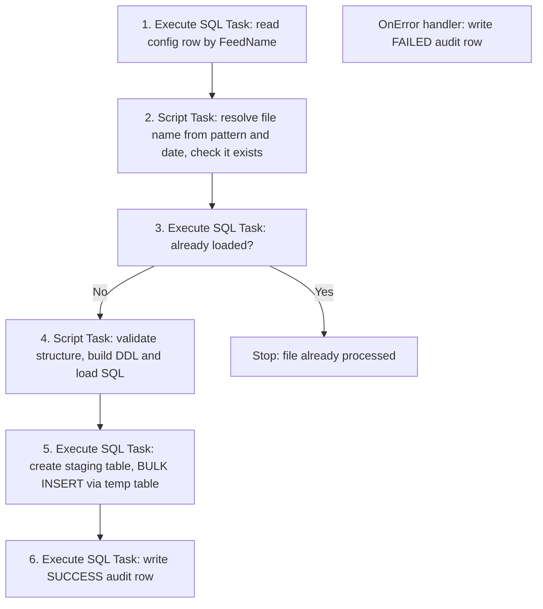
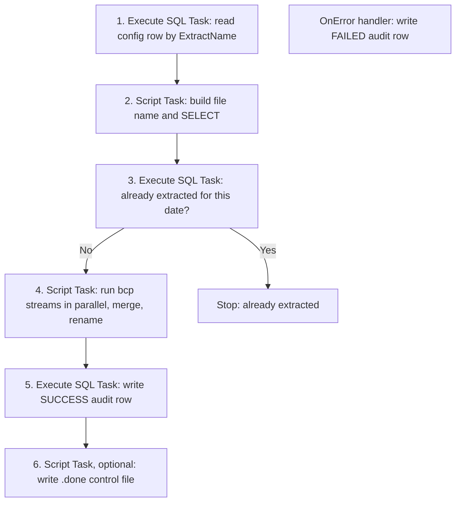

# Metadata-Driven File Load and Extract for SSIS

Load any delimited file into SQL Server, and extract any table or query back out to a file, using two SSIS packages driven by config tables. Adding a new feed or a new extract means adding a row to a config table. No new package, no redeployment.

Both packages live in one SSIS solution and are designed for large files, from millions up to billions of records.

---

## Why plain code and not AI?

Most warehouse ETL follows the same flow: structured files are loaded into staging, the data is processed and transformed, and the result is extracted for analysis. The two ends of that flow, loading and exporting, deal with files that have a known structure (a delimiter, a header or a fixed list of fields, a predictable file name). That can be described once and automated with ordinary code.

We were asked to use AI for this. We chose not to, because:

- **Cost follows volume.** AI models bill per token, so millions or billions of records mean billions of tokens on every run. Code running on a database you already own costs almost nothing per row.
- **Same input, same output.** A deterministic loader behaves identically every time. Even a tiny error rate becomes a lot of bad rows at this scale.
- **Speed.** SQL Server's bulk tools read straight from disk. A round trip to a model for every chunk cannot compete.
- **Control.** Data stays inside your environment, and every step can be audited and replayed.

AI is still useful for unstructured sources, for exploring an unfamiliar file, and for helping to write the code. The rule of thumb here: use AI to help build the pipeline, not to run it on every row.

---

## What is in this repo

> Folder names are a suggestion. Adjust them to match your repository.

```text
.
├── README.md
├── solution/
│   ├── meta_data_driven_file_ingestion_b.dtsx         # inbound: file -> staging table
│   ├── meta_data_driven_file_extract_b.dtsx           # outbound: table or query -> file
│   └── ...                                            # project and connection manager files
├── Sql/
│   ├── extract.sql                                    # FileConfig amd audit for extract
│   ├── file_load.sql                                  # FileConfig amd audit for file load
├── samples/
│   └── CUSTOMER_20261020.csv                          # small test file
└── docs/
    └── ...                                            # blog posts, diagrams
```

---

## How the load works



1. **Read config.** The package receives `FeedName` and `FileDate`. Everything else (path, file name pattern, delimiter, header flag, field count, staging table) comes from `FileConfig`.
2. **Resolve the file.** Date tokens in the pattern, such as `CUSTOMER_{yyyyMMdd}.csv`, are replaced with the formatted date. The run fails if the file does not exist.
3. **Check for duplicates.** If the audit table already has a SUCCESS row for this feed and file, the run stops.
4. **Validate and generate SQL.** The Script Task reads the first row only.
   - File **has a header**: the header's field count must equal `FieldCount`, and the header supplies the column names.
   - File **has no header**: the names come from `FieldNames` in the config, their count must equal `FieldCount`, and the first data row must have the same number of fields.
   - Column names are sanitized (unsafe characters become underscores, empty names become `Col1`, `Col2`, duplicates get a numeric suffix).
5. **Create staging and load.** Every staging column is `NVARCHAR(4000)`. The load runs as one SQL batch: create a temp table with only the file's columns, `BULK INSERT` the file into it, then `INSERT` into the staging table with an explicit column list.
6. **Audit.** One row per run, SUCCESS or FAILED.

The data never passes through the SSIS process. SQL Server reads the file itself.

---

## How the extract works



1. **Read config.** The package receives `ExtractName` and `ExtractDate`.
2. **Build the query.** From `SourceSchema`, `SourceObject`, `ColumnList`, `DateColumn` and `WhereClause`, or from `CustomQuery` if provided. `DateColumn` is filtered to the whole `ExtractDate` day, and the filter column never appears in the file unless it is in `ColumnList`.
3. **Check for duplicates.** Stops if this extract was already produced for this date.
4. **Write the file.**
   - The query is described with `sp_describe_first_result_set`, then wrapped so every row becomes one formatted text column (quoting, dates, numbers and NULLs handled in SQL).
   - With `ParallelStreams = N`, N `bcp` processes each export a slice of the rows, split on `PartitionColumn`.
   - Part files are merged with the header line, then the file is renamed from `.tmp` to its final name, so a downstream process never sees a half-written file.
5. **Audit**, then optionally write a `.done` file containing the row count.

---

## Prerequisites

- SQL Server 2017 or later (`BULK INSERT ... FORMAT = 'CSV'` is required for quoted fields).
- Visual Studio with SQL Server Integration Services Projects, to open and deploy the solution. The packages were built with the project version 17.0 tooling.
- An **ADO.NET** connection manager named `StagingDB` (SqlClient Data Provider or Microsoft.Data.SqlClient, both work), pointing to the database that holds the config, audit and staging tables.
- An OLE DB connection for the Execute SQL Tasks that read config and write audit rows.
- **Load:** the input file must be readable by the **SQL Server service account**, because `BULK INSERT` runs on the database server. Use a local path on that server or a UNC share. Mapped drive letters do not work.
- **Extract:** `bcp` must be installed on the machine that runs the package (SQL Server command line utilities and an ODBC driver), and be on the PATH of the account that runs it, or have its full path set in the `BcpPath` variable.

---

## Setup

1. Run the SQL scripts in `sql/` in order to create the config and audit tables.
2. Open the solution, set the connection managers to your server and database, and deploy to the SSISDB catalog.
3. Insert a row in `FileConfig` or `ExtractConfig` (examples below).
4. Execute the package with the parameters shown in the next sections.

The scripts use the `dbo` schema. If you keep the tables in a different schema, update the schema in the Execute SQL Task statements as well.

---

## Configure a load

`FileConfig` has one row per feed.

| Column | Purpose |
|---|---|
| `FeedName` | Name passed to the package. Unique. |
| `FilePath` | Folder that holds the file. |
| `FileNamePattern` | File name with date tokens, for example `CUSTOMER_{yyyyMMdd}.csv`. |
| `Delimiter` | `,` or `\|` or `TAB`. |
| `HasHeader` | 1 if the first row is a header. |
| `FieldCount` | Expected number of fields. |
| `FieldNames` | Comma-separated names, used when there is no header. |
| `StagingSchema`, `StagingTable` | Where the data lands. The table is recreated on every run. |
| `ArchivePath` | Optional folder for processed files. |
| `IsActive` | 1 to enable. |

Example for the sample file in `samples/`:

```sql
INSERT INTO dbo.FileConfig
    (FeedName, FilePath, FileNamePattern, Delimiter, HasHeader, FieldCount,
     StagingSchema, StagingTable)
VALUES
    ('CUSTOMER', 'E:\Data\inbound', 'CUSTOMER_{yyyyMMdd}.csv', ',', 1, 5,
     'stg', 'Customer');
```

Run it (SSISDB catalog):

```sql
DECLARE @id BIGINT;
EXEC SSISDB.catalog.create_execution
     @folder_name = 'ETL', @project_name = 'DynamicLoad',
     @package_name = 'DynamicFileLoad.dtsx', @execution_id = @id OUTPUT;

EXEC SSISDB.catalog.set_execution_parameter_value @id, @object_type = 30,
     @parameter_name = 'FeedName', @parameter_value = 'CUSTOMER';
EXEC SSISDB.catalog.set_execution_parameter_value @id, @object_type = 30,
     @parameter_name = 'FileDate', @parameter_value = '2026-10-20';

EXEC SSISDB.catalog.start_execution @id;
```

---

## Configure an extract

`ExtractConfig` has one row per extract.

| Column | Purpose |
|---|---|
| `ExtractName` | Name passed to the package. Unique. |
| `SourceSchema`, `SourceObject` | Table or view to read. |
| `ColumnList` | Comma-separated columns to include. Blank means all. |
| `DateColumn` | Column filtered to the `ExtractDate` day. Optional. |
| `WhereClause` | Extra static filter. Optional. |
| `CustomQuery` | Full query that overrides the five columns above. May use `@ExtractDate`. |
| `Delimiter`, `TextQualifier`, `IncludeHeader`, `FileEncoding` | Output format. Encodings: `UTF8`, `UTF8BOM`, `ASCII`, `UTF16`. |
| `OutputPath`, `OutputFileNamePattern` | Where the file goes and what it is called. |
| `ParallelStreams` | Number of bcp processes. `1` for small extracts. |
| `PartitionColumn` | Column used to split rows between streams. Needed when `ParallelStreams` is above 1. |
| `CreateDoneFile` | 1 to write a `.done` control file. |
| `IsActive` | 1 to enable. |

Example: extract the business columns of a staging table for one load date, leaving out the housekeeping columns that start with an underscore:

```sql
INSERT INTO dbo.ExtractConfig
    (ExtractName, SourceSchema, SourceObject, ColumnList, DateColumn,
     Delimiter, TextQualifier, IncludeHeader, FileEncoding,
     OutputPath, OutputFileNamePattern, ParallelStreams, PartitionColumn,
     CreateDoneFile)
VALUES
    ('CUSTOMER_EXT', 'stg', 'Customer',
     'CustomerID,FirstName,LastName,City,Country', '_LoadDate',
     ',', '"', 1, 'UTF8',
     'E:\Data\outbound', 'CUSTOMER_EXT_{yyyyMMdd}.csv', 4, '_RowId',
     0);
```

Run it:

```sql
DECLARE @id BIGINT;
EXEC SSISDB.catalog.create_execution
     @folder_name = 'ETL', @project_name = 'DynamicExtract',
     @package_name = 'DynamicFileExtract.dtsx', @execution_id = @id OUTPUT;

EXEC SSISDB.catalog.set_execution_parameter_value @id, @object_type = 30,
     @parameter_name = 'ExtractName', @parameter_value = 'CUSTOMER_EXT';
EXEC SSISDB.catalog.set_execution_parameter_value @id, @object_type = 30,
     @parameter_name = 'ExtractDate', @parameter_value = '2026-10-20';

EXEC SSISDB.catalog.start_execution @id;
```

When `ParallelStreams` is above 1, the query must contain a `{PARTITION}` placeholder. It is added automatically for table-based configs. For a `CustomQuery`, put `{PARTITION}` in your own WHERE clause.

---

## Audit and duplicate protection

- `FileLoadAudit` and `ExtractAudit` record the name, date, file, row count, status, error text, execution id and timestamp of every run.
- Before doing any work, each package asks the audit table whether a SUCCESS row already exists and stops if it does.
- A filtered unique index on SUCCESS rows enforces the same rule in the database, so two simultaneous runs cannot both succeed.
- A package-level OnError handler writes FAILED rows.

---

## Design notes

- **No Data Flow Task.** Data flow column metadata is fixed at design time, which cannot handle a different column count per file. The dynamic part lives in Script Tasks that generate SQL.
- **Staging holds strings only.** Typing and validation happen in the next transformation step, where bad values can be handled with business rules instead of failing the load.
- **Load goes through a temp table.** `BULK INSERT` maps fields to columns by position, so the temp table holds only the file's columns. The staging table can keep its own housekeeping columns, filled by identity and defaults.
- **Extract writes `.tmp`, then renames.** Downstream systems never see a partial file.

---

## Troubleshooting

| Symptom | Cause and fix |
|---|---|
| `DBNull` assigned to a String variable when reading config | An OLE DB Execute SQL Task cannot map `VARCHAR(MAX)` into a String variable. Cast long columns to `VARCHAR(8000)` in the config query, and use `ISNULL` for nullable ones. |
| Invalid cast to `SqlConnection` in a Script Task | The connection uses the other SqlClient provider. Cast to `System.Data.Common.DbConnection`, which works with both. |
| `The connection "StagingDB" is not found` | Use the plain name in code. `(project)` in the designer is only a label. The connection must be in the same SSIS project as the package. |
| `Cannot obtain the required interface (IID_IColumnsInfo)` or `column N (_LoadDate)` conversion errors | The target of `BULK INSERT` has more columns than the file. Load into a table with only the file's columns. Also check the file path is visible to the SQL Server service account. |
| `Failed to lock variable "$Package::FeedName"` | A task copied from another package still references its variables or parameters. Re-map the parameter bindings, including in the OnError handler. |
| `No active config row found` | The `FeedName` or `ExtractName` parameter does not match the config row, or `IsActive` is 0. Check the parameter's default value too. |
| bcp: `Login failed for user` | SSIS does not include the password in a connection manager's `ConnectionString`. Use Windows authentication, or make sure the password is available from the opened connection. |
| bcp certificate error with ODBC Driver 18 | Add `-u` to the `BcpExtraArgs` variable. |
| bcp: `Packet size change not supported` | Harmless warning, usually alongside a login failure. Fix the login first. |

---

## Known limitations

- All staging columns are text. Typed conversion is a downstream step.
- The temp-table hop writes the data twice and needs tempdb space. A regular work table is a drop-in alternative.
- Load rejects are all-or-nothing (`MAXERRORS = 0`). An error file and a reject threshold are a natural next step.
- Fixed-width and multi-record-type files need their own parser.
- Parallel extract writes streams in order (all of stream 0, then stream 1, and so on), not in the source row order. The modulo split makes each stream scan the table. A range split on a clustered key avoids that.
- The bcp password is visible in the process list while bcp runs. Prefer Windows authentication or a dedicated low-privilege login.
- Test the parallel extract at your own data volume and tune `ParallelStreams` from measured results.

---

